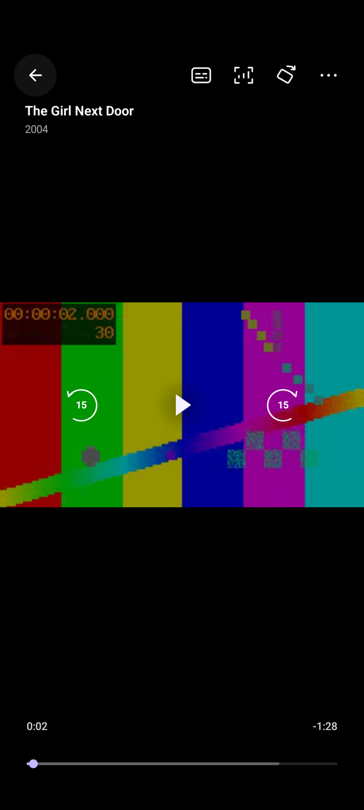
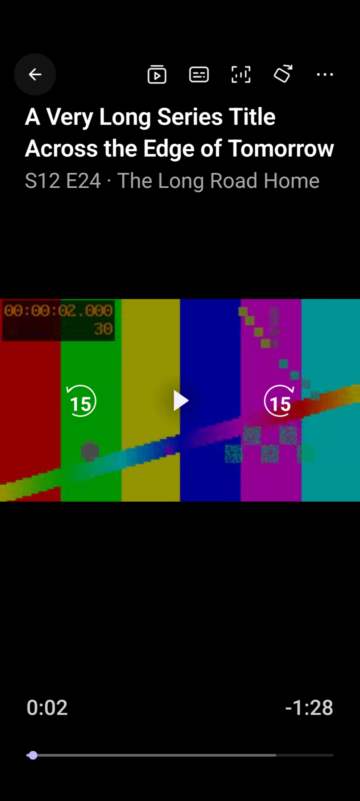
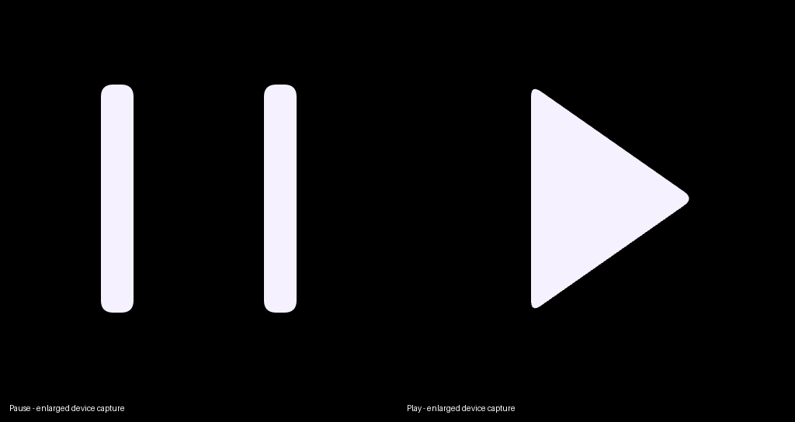
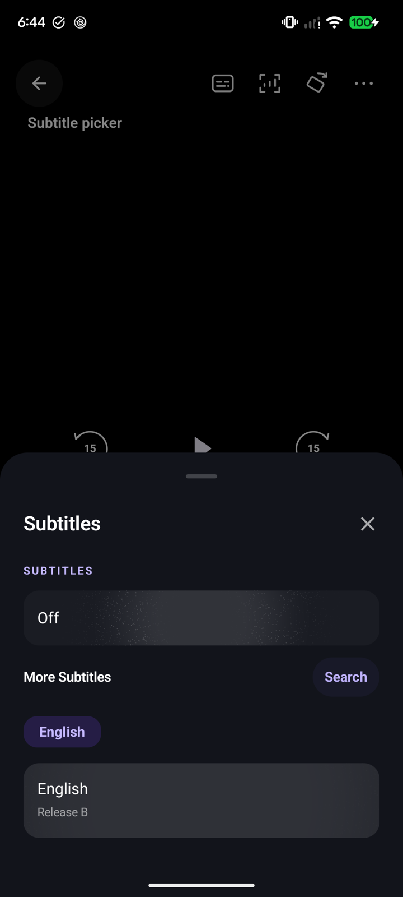
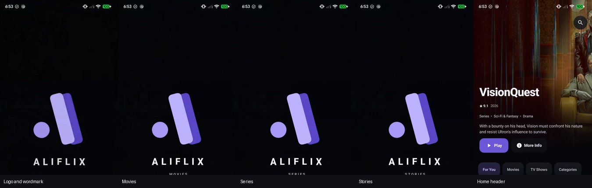

# Mobile v3.1.162 motion and interaction refinements

Base: latest GitHub mobile release v3.1.161, commit 4902005.

## Launch

The logo and wordmark share a single 1.08-to-1 camera settle and upward 8dp movement, finishing at 420ms. The wordmark retains a masked reveal over 80–420ms, with matching easing; its former independent 3.306-to-1 zoom is removed.

Movies starts at 520ms and Series at 1020ms, each with 100ms entry, 300ms hold and 100ms exit. Stories starts at 1520ms with a 100ms entry and 260ms still hold. The sequence finishes at 1880ms and hands off through a 160ms crossfade, for a nominal branded path of 2040ms. This gives each short word reading time without adding a separate wait after Stories.

Home prepares at 1620ms, when Stories has finished entering and is still, with two frame boundaries before composition and two after layout. Pixel profiling caught a roughly 280ms first Home composition when preparation began during Movies; placing that work after all moving word phases prevents it from blocking the word transitions. There is no additional timed wait after preparation. Ready content can enter at the sequence end. If networking is slow, the branded screen can exit at the 2000ms animation-clock cap into Home's existing loading skeleton, once its first frame is available. Reduced motion uses a static 150ms minimum, a 300ms network cap and the same 160ms crossfade. These are animation-clock budgets; Android's system starting window, first Home rendering and device scheduling are separate.

Launch frame state is still read in drawing/graphics layers and milestone observers. The catalogue does not recompose on each animation frame.

## Player and Ask Aliflix

- Ask result bookmarks occupy the upper-right card corner with a 48dp target; they no longer cover the poster. Title width reserves the bookmark space, including narrow layouts and large fonts.
- Portrait puts the familiar back button and right-aligned action group on one top baseline. Adjacent actions retain 48dp touch targets without extra gaps; title and episode details sit 6dp below, with the full width reserved for long names and up to two detail lines. More stays beside rotation and quality. Landscape placement and the custom line icons are retained. Very narrow layouts wrap actions with right alignment.
- The play/pause glyph keeps its slim proportions and morph. Exposed corners use short quadratic curves, including the play tip and pause-bar ends. The two morph halves form one filled silhouette to prevent an antialias seam. Its hard circular surface and border are replaced by an edge-free, feathered shadow.
- The direct subtitle shortcut opens only Off, embedded tracks, More Subtitles, Search and results. More > Audio & subtitles retains the existing audio, Sync with Audio, timing and appearance options. The web fallback also separates its track picker from advanced presentation controls.

## Inspected transition reference

The exact Component.tsx and interactive preview were inspected through the normal source view:
https://21st.dev/@serafimcloud/components/floating-action-button

Serafim's MIT-licensed component animates icon scale from 0.9 to 1, rotation from 45 to 0 degrees and blur from 2px to 0 over 400ms. Its moving cover and plus-button rotation use 500ms. This implementation adapts only the icon reveal, shortened to 180ms, with a 120ms dismissal. It adds no cover, plus button, action cards or dependencies. Header glyphs use the reference geometry; transport glyphs keep their orientation. Identity, scrim, actions, transport and timeline share one visibility transition with no child delays. Android 29–30 use scale/rotation/fade without GPU blur; reduced motion is immediate.

## Validation

Regression coverage includes bookmark/poster separation at narrow widths and large fonts, brief final-word timing, deferred Home composition outside moving word phases and bounded network wait, synchronized control appearance, absence of a hard playback ring, curved glyph corners without an internal seam, subtitle-only shortcut contents and advanced settings through More. Full player renders cover portrait/landscape, movies/long series identities and 100%/200% fonts. The existing Home pinning, toggle, quality migration, launch recomposition and playback tests remain enabled.

Final local gate: mobile assembly, Android-test assembly, 623 unit tests (620 passed, 3 skipped), mobile lint and TV assembly passed. The unchanged recommendation Worker passed typecheck and all 116 tests.

Physical Pixel 7a: 31 focused instrumentation tests passed in 53.512s. Eight full-player renders cover both orientations, movie/long series identities and 100%/200% fonts. The rendered video is a local diagnostic asset decoded by Media3 under the production overlay. Enlarged play/pause captures and pixel checks verify curved corners and a solid joined silhouette. The final real cold-launch recording was inspected separately from the clock-controlled launch tests.

Three cold AOT-compiled validation launches returned frame p95 values of 5.65, 8.15 and 6.86ms in the diagnostic 0.2–1.88s sampling window. The largest samples were 99.78–272.9ms, including first Home composition during the final still phase. These measurements use the debug validation APK.

Device test APKs use `com.aliflix.app.validation`, preserving the installed main app and data. Physical rendering and production signed-artifact verification are separate checks. TV sources/resources/version and runtime dependencies are unchanged.

## Physical-device captures

[Portrait overview: four title/font combinations](images/mobile-162/portrait-overview.jpg) · [Landscape overview](images/mobile-162/landscape-overview.jpg)

[Advanced settings through More](images/mobile-162/advanced-settings-through-more.png)

